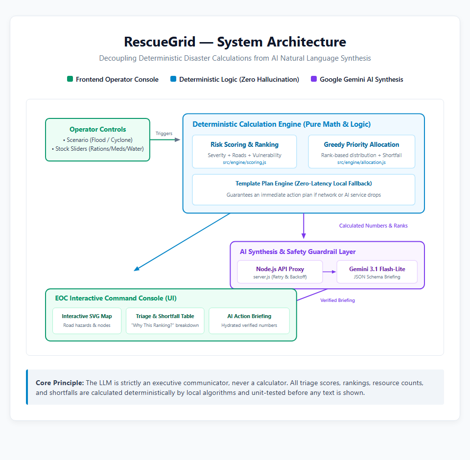

# RescueGrid — Simulated Disaster Response Decision-Support Console

> A single-screen, high-density disaster response command console for district disaster agencies and NGOs. RescueGrid combines deterministic community risk scoring and greedy supply triage with auditable, hallucination-proof AI emergency action plans. Uses 100% simulated data.

---

## The Core Concept & Unique Kernel

In disaster management, decisions must be transparent, repeatable, and auditable. RescueGrid maintains a strict separation of concerns between math and generative AI:

1. **Deterministic Core (Math & Spatial)**: Multi-factor risk scoring (Exposure, Vulnerable Population, Road Access, Depot Distance) and priority supply allocation (food packets, drinking water units, medical kits) are computed strictly via pure rule-based algorithms. Factor breakdown points sum identically to the displayed total score.
2. **Generative Synthesis (AI & Guardrails)**: The AI does not compute numbers—it synthesizes human-actionable emergency directives. The model outputs structured JSON with template placeholders (e.g. `{{c1.food}}`), which the client validates for rank order and digit allow-lists before hydrating with exact computed figures.
3. **Automated Fallbacks**: If the AI API is unavailable, times out, or fails validation (e.g., attempts to invent numbers or violates rank order), the console instantly renders a deterministic template-based action plan with clear audit badges.

### System Architecture


---

## Quickstart & How to Run

### Prerequisites
- Node.js (v18.0.0 or higher). Zero external npm dependencies are required.

### 1. Launch the Local Console
```bash
# Clone the repository
git clone https://github.com/your-username/RescueGrid.git
cd RescueGrid

# Optional: Configure Gemini API Key for live AI briefings
# (If omitted, the console operates completely offline using the template fallback engine)
cp .env.example .env

# Start the zero-dependency local server
node server.js
# Or: npm start
```

Open your browser and navigate to:
```
http://localhost:3000
```

### 2. Run the Automated Test Suite
RescueGrid includes a full unit test suite using Node's native test runner covering scoring formulas, factor sums, tie-breaking, greedy allocation limits, and guardrail validation:
```bash
npm test
# Or: node --test tests/*.test.js
```

---

## Guardrail Demonstration & Test Hooks

To easily test and demonstrate the safety guardrails during reviews or evaluations, the application includes URL query parameter test hooks:

| URL Parameter | Triggered Behavior | Displayed Audit Badge |
|---|---|---|
| `http://localhost:3000` | Standard operation (Live Gemini brief if key configured, or offline fallback if no key) | `AI-drafted, validated` or `Standard plan (AI unavailable)` |
| `http://localhost:3000?ai=off` | Simulates network disconnection or API service outage | `Standard plan (AI unavailable)` |
| `http://localhost:3000?ai=bad` | Simulates a model hallucination (injects raw ungrounded numbers and rank order violation) | `Standard plan (AI output failed validation)` |

---

## Project Structure

```
RescueGrid/
├── server.js                 # Zero-dependency static file server + POST /api/brief proxy
├── index.html                # EOC Command Console layout and containers
├── package.json              # ES module manifest and test scripts
├── .env.example              # Secret-free environment template
├── .gitignore                # Ignores .env and personal learning context
├── styles/
│   └── main.css              # Dark EOC theme, grid layout, dual-coded status badges
├── src/
│   ├── app.js                # State coordinator & event hub
│   ├── data/
│   │   └── district.json     # 8 fictional communities, roads with status, central depot
│   ├── engine/
│   │   ├── scoring.js        # Deterministic multi-factor scoring formula & tie-breaker
│   │   ├── allocation.js     # Scaled demand & greedy supply allocation
│   │   └── templatePlan.js   # Deterministic fallback emergency action plan generator
│   ├── components/
│   │   ├── controls.js       # Scenario switcher & supply sliders with unapplied cue
│   │   ├── map.js            # Custom interactive SVG map with road hazard paths
│   │   ├── triageTable.js    # Ranked community list & "Why this ranking?" expander
│   │   ├── allocationTable.js# Resource distribution table & shortfall summary strip
│   │   └── actionPlan.js     # Action brief display, skeleton loader & badge renderer
│   └── services/
│       └── aiBriefing.js     # Client API client, placeholder hydration & strict validation guardrail
├── tests/
│   ├── engine.test.js        # Unit tests for scoring sums, tie-breaks, and allocation limits
│   └── guardrail.test.js     # Unit tests verifying rejection of invented numbers & wrong ranks
└── devpost/                  # Planning specifications and review artifacts
    ├── scope.md              # Approved Scope definition
    ├── scope.html            # Visual Scope companion
    ├── prd.md                # Approved Product Requirements Document
    ├── prd.html              # Visual PRD companion
    ├── spec.md               # Approved Technical Specification
    ├── spec.html             # Visual Technical Spec companion
    └── checklist.md          # Slices and build progress checklist
```

---

## Design System & Accessibility
- **Command Console Theme**: Deep navy and dark slate base (`#070b14`, `#0f172a`), teal/cyan active accents (`#0d9488`, `#06b6d4`).
- **Color-Blind Accessible Indicators**: Every risk level and shortfall state is dual-encoded with both color and distinct geometric symbols (`[✓] Low`, `[▲] Med / Partial`, `[!] High`, `[✖] Crit / Unmet Need`).
- **Tabular Figures**: Tabular monospace numbers (`JetBrains Mono`) for all counters, sliders, and triage metrics prevent layout shift during updates.
- **Offline Reliability**: The district map is rendered via vector SVG with zero external map tile servers or rate limits.

---

## License
MIT License.
